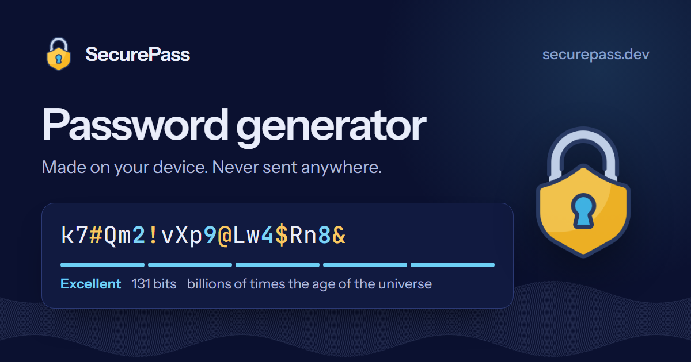

<p align="center"></p>

<h1 align="center">SecurePass</h1>

<p align="center">A free, open-source password generator that never sends your passwords anywhere.<br><a href="https://securepass.dev"><strong>securepass.dev</strong></a></p>



SecurePass generates random passwords, passphrases and PINs, and checks how long an existing password would hold up against a real attack. Everything happens in your browser.

- No server sees what you generate or type.
- No analytics, cookies or third-party scripts.
- It keeps working with your connection turned off.
- The page shows how to check every one of those claims yourself.

## What it does

- **Password generator.**
  - 8 to 128 characters, from any mix of upper case, lower case, digits and symbols.
  - Options to avoid look-alike characters or exclude specific ones.
  - Every enabled character type is guaranteed to appear, without biasing the result.
- **Passphrase generator.** 3 to 12 words from the [EFF long wordlist](https://www.eff.org/deeplinks/2016/07/new-wordlists-random-passphrases), with a choice of separator, capitalisation and an optional number.
- **PIN generator.** 4 to 12 digits, for places that limit wrong guesses.
- **Strength checker.**
  - Pattern-aware estimates from [zxcvbn-ts](https://github.com/zxcvbn-ts/zxcvbn), with specific warnings and suggestions.
  - An opt-in breach check against [Have I Been Pwned](https://haveibeenpwned.com/Passwords) that sends only five characters of a hash.
- **Honest crack times.**
  - The headline assumes an attacker with 12 RTX 5090 GPUs guessing 3 trillion times a second against a fast hash.
  - Three gentler scenarios are shown on demand.

## How it keeps your passwords to yourself

| Guarantee | How |
|---|---|
| Unbiased randomness | Every character comes from `crypto.getRandomValues` with rejection sampling, so there is no modulo bias. Passwords that must include every character type are redrawn whole, which keeps them uniform. With no secure random source, the tool refuses to run. |
| Exact strength | A generated password's entropy is counted exactly, by inclusion-exclusion over the valid strings. |
| Nothing sent | Generation and analysis run on the device. A live counter in the header shows requests to other sites; it stays at 0 unless you run a breach check. |
| Private breach check | k-anonymity: only the first 5 of the 40 hex characters of the password's SHA-1 are sent, with response padding, no cookies and no referrer. The match happens locally. |
| Locked-down page | A strict Content Security Policy forbids eval and unhashed inline script, framing, plugins, and connections anywhere except the breach API. The only inline script is a hash-pinned theme bootstrap. |
| No DOM injection | Trusted Types are enforced, with one policy that admits only `/sw.js`. |
| Hardened headers | HSTS (preload), `no-referrer`, COOP, COEP and CORP, and a Permissions-Policy that switches off every device capability the tool doesn't use. All defined once, in [`src/security/headers.ts`](src/security/headers.ts). |
| Nothing stored | The only things stored are non-secret settings (length, character choices, theme), in local storage. |
| No leaks through the browser | Secrets are never put in the URL or history. The check field opts out of autofill, spellcheck and password managers, and is wiped on page hide and back/forward-cache restore. Secrets are marked `translate="no"` so automatic translation never sends them away. |
| Works offline | A hand-written service worker precaches every page, script, font, wordlist and estimator dictionary. |
| Free to run | An assets-only Cloudflare Worker: no code runs for a page request, and static asset requests are free. |

## Architecture

```text
src/
  core/        pure, tested generators: random, charsets, password, passphrase, pin, entropy, crack time, ratings
  check/       lazy zxcvbn-ts estimator, HIBP k-anonymity breach lookup
  app/         browser UI: generator, checker, network meter, theme, preferences, service worker registration
  pages/       build-time renderer: the five prerendered pages, content, routes, structured data
  security/    headers.ts, the single source of truth for every response header
  styles/      design tokens, components, sections (no framework)
  sw/          the service worker template
build/         local Vite plugins: page prerendering, _headers, service worker, wordlist
workers/       a 10-line Worker that redirects www to the apex
scripts/       brand assets, deploy with an account guard, production smoke check
tests/         Vitest unit tests and Playwright browser tests
```

- **Stack:** Vite 8, vanilla TypeScript, Vitest, Playwright and Wrangler.
- **Runtime dependency:** zxcvbn-ts only. It is loaded only when you first use the strength checker.

## Development

```bash
npm ci
npm run dev          # Vite dev server
npm run typecheck
npm test             # unit tests
npm run build        # writes dist/, including _headers and sw.js
npm run test:e2e     # browser tests against the built site on wrangler dev
npm run brand        # re-render favicons and preview images
```

The browser tests serve `dist/` through `wrangler dev`, so the real CSP, Trusted Types and cross-origin isolation apply. Every test fails on any CSP violation or console error. Run `LIVE=1 npm run test:e2e` to include the test that calls the real breach API.

## Deploying

`npm run deploy` checks the account before it touches anything:

- With `SECUREPASS_DEPLOY_TOKEN` set, the token must verify as an Account API Token of the personal Cloudflare account.
- Without it, `wrangler whoami` must show the personal OAuth login and that account.

The deploy then builds the site, uploads it and the www redirect Worker, and runs `npm run smoke` against production.

CI (`.github/workflows/ci.yml`) runs the typecheck, unit tests, build and browser tests on every pull request and push. It deploys `main` once the `SECUREPASS_DEPLOY_TOKEN` secret exists in the repository's `production` environment. To enable it, create an Account API Token on the personal Cloudflare account with these permissions:

- **Account** - Workers Scripts - Edit
- **Zone** (securepass.dev) - Workers Routes - Edit
- **Zone** (securepass.dev) - Zone - Read

Before adding the token, make sure the repository's `production` environment allows deployments from `main` only:

1. Open **Settings**, then **Environments**, then **production**.
2. Under **Deployment branches and tags**, choose **Selected branches and tags**.
3. Allow only `main`.

That way no other branch can reach the token. Then add it as an environment secret of `production`.

## Security

See [SECURITY.md](SECURITY.md) to report a vulnerability. The site publishes [`/.well-known/security.txt`](https://securepass.dev/.well-known/security.txt).

## Credits and license

The code is [MIT](LICENSE) licensed. Credits:

- **Vault icon:** [Security icons created by Vectors Tank - Flaticon](https://www.flaticon.com/free-icons/security). It is not covered by the MIT license.
- **Passphrase words:** the EFF Long Wordlist (CC BY 3.0 US).
- **Breach data:** Have I Been Pwned.
- **Strength estimates:** zxcvbn-ts (MIT).
- **Fonts:** Instrument Sans and JetBrains Mono (SIL OFL).

See [THIRD_PARTY_NOTICES.md](THIRD_PARTY_NOTICES.md). Built by [Matt Berry](https://matt-berry.com).
