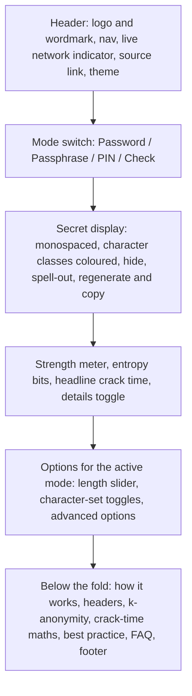
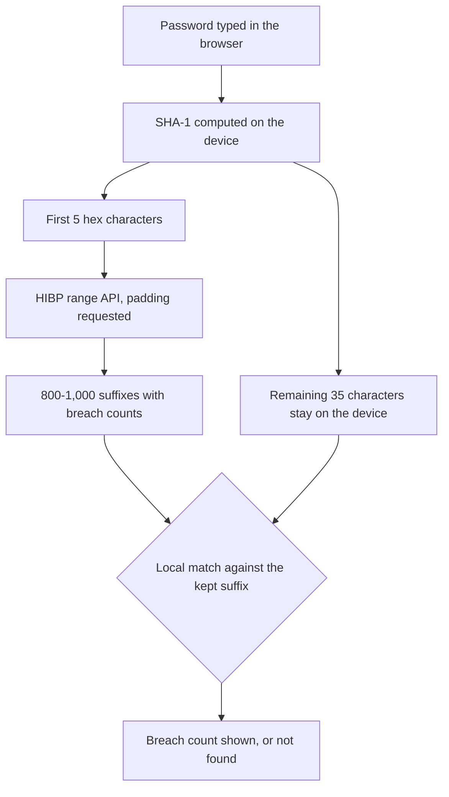
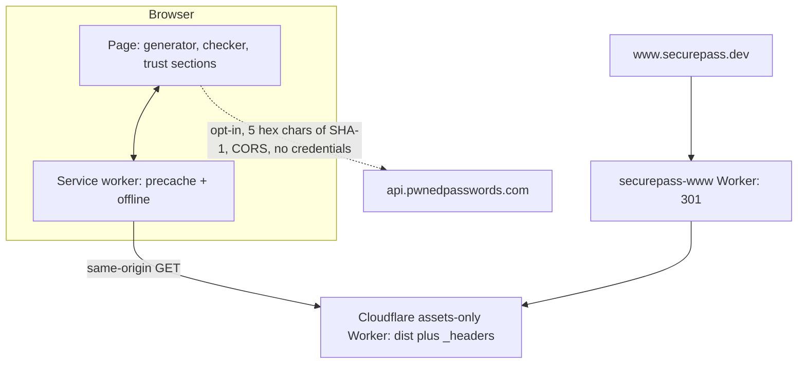
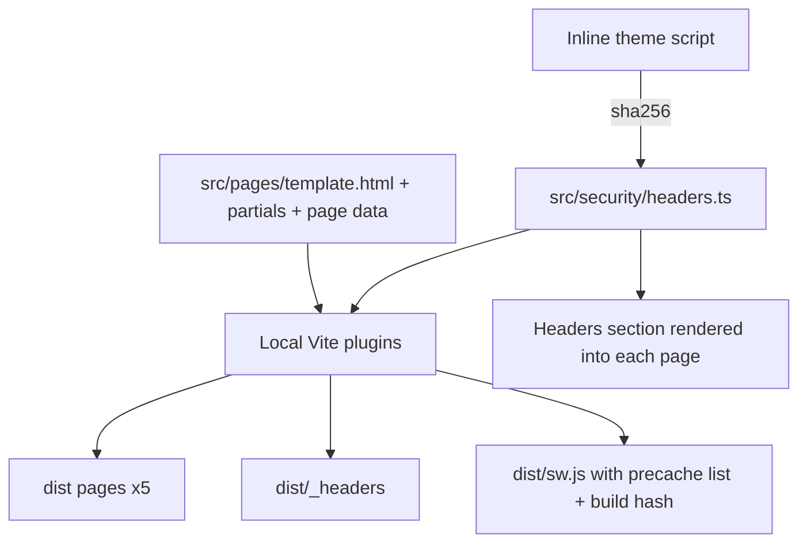
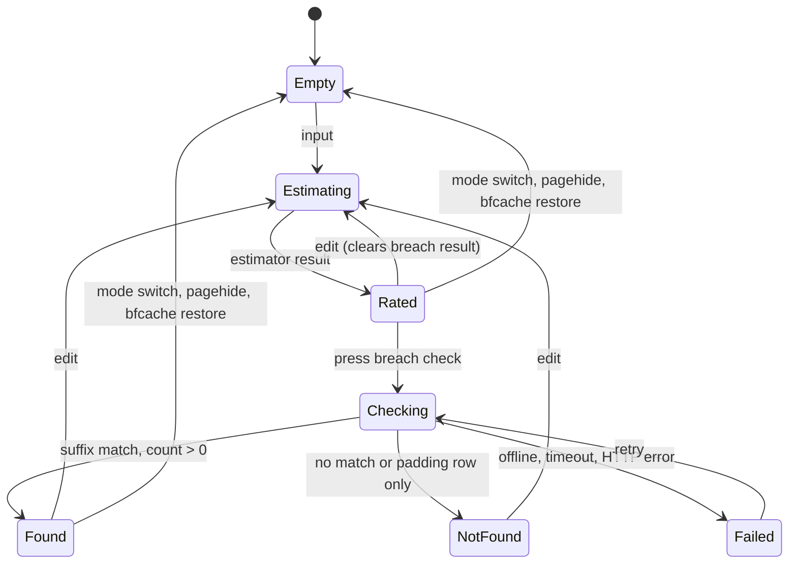

# SecurePass Offline Password Generator - Plan

## Goal Capsule

- **Objective:** Anyone who visits securepass.dev can make a password, passphrase or PIN that is infeasible to crack, or test a password they already have. The site never sends anything they generate or type anywhere, and the page shows them how to check that for themselves.
- **Means:** A static, framework-free web app served by an assets-only Cloudflare Worker, behind a strict, Trusted-Types-enforced content security policy (KTD1, KTD2, KTD3).
- **Product authority:**
  - The owner's brief of 2026-10-11 governs.
  - The run is autonomous: the owner asked for no questions, so product and technical calls are recorded below as Key Decisions, Key Technical Decisions and Assumptions.
  - Hosting is the owner's personal Cloudflare account and the Moose-Ltd GitHub org, never the owner's work accounts.
- **Execution profile:** One autonomous `ce-work` run implements U1 to U11 in order, runs code review, and deploys to production at https://securepass.dev.
- **Stop conditions:** Stop and report instead of improvising if:
  - the account guard cannot prove the personal Cloudflare account;
  - the custom-domain attach fails for a reason other than a fixable DNS conflict;
  - a requirement cannot be met without loosening the CSP in R18.
- **Score-chasing limit:** after two fix-and-rerun rounds on a lab score (Lighthouse, Observatory), stop and report the remaining gap and its cause rather than churning on measurement variance.
- **Open blockers:** None. The CI deploy credential is an owner follow-up (see Dependencies / Assumptions); until it exists, production deploys run from the workstation.

---

## Product Contract

**Product Contract preservation:** changed. The R1 to R34 IDs and their meanings are kept, with these changes:
- R16 and AE3 are reworded. R9 now names PIN mode's neutral badge. AE1 now tests against the exact distribution over valid passwords, which R4 requires, instead of a naive uniform.
- R25 now lists the network indicator.
- R35 to R43 and AE10 to AE13 are new. They close gaps found by a flow and edge-case analysis.
- The outstanding questions were resolved in planning and removed.

The owner delegated every decision, so there was no confirmation step.

### Summary

securepass.dev is a single-page, open-source password tool served as static files from a Cloudflare Worker.
On every device the first screen is the tool. It generates a random password, passphrase or PIN with a live crack-time estimate, or checks how strong an existing password is. The breach lookup is opt-in and sends only five characters of a hash.
Below the tool, the page explains how it keeps that promise: on-device randomness, a locked-down content security policy, a live network counter, no storage, and k-anonymity.

### Problem Frame

Most password generators ask you to trust a server you cannot see.
Many load analytics, ads and third-party scripts on the same page that displays your new password, and some strength checkers send the password itself to an API.
Security-minded people cannot tell which tools are safe, and the safe ones rarely prove it.
The owner wants a portfolio piece that does the job better than the common generators, costs nothing to run, and makes its privacy claims checkable instead of asserted.

### Key Decisions

- **The breach check is opt-in and never automatic.** The brief asks for both "no network requests" and a leaked-password check. The only way to keep both is for nothing to leave until the user presses the check button, and then only a five-character hash prefix. Governs R14, R15, R19, R37.
- **Have I Been Pwned's Pwned Passwords instead of XposedOrNot.** HIBP's range API is the industry reference. It is free, needs no key, has no rate limit, allows the padding header across origins, and needs no attribution. Governs R14.
- **Exact entropy for generated secrets, pattern-based estimation for typed ones.** A generated secret's strength follows exactly from its alphabet and length. A human-chosen password needs a dictionary and pattern estimator, because an entropy formula overrates "Password1!". Governs R9, R12.
- **The headline crack time favours the attacker.** It assumes an offline attack on a fast hash by a 12-GPU rig, so the number never flatters the password. Governs R10.
- **Static, assets-only delivery.** No server code runs for a page request, so there is nothing server-side to compromise or pay for. Governs R18, R34.
- **Each tool mode gets its own URL for search.** Every mode is a crawlable page, and switching modes on the page stays instant. Governs R28, R39.
- **Public source code.** A security tool is more credible when its code can be read. Governs R30, R32.
- **No history, no accounts, no cloud features.** Anything the tool remembers is something that can leak. Only non-secret preferences persist, and only on the device. Governs R16, R39.
- **Make the privacy claim precise, then prove it.** "The site never sends your passwords" is true and checkable. "Nothing leaves your device" is not, because of clipboard sync and extensions. The page says what it does not protect against. Governs R16, R35.

### Requirements

**Generation**

- R1. The tool generates three kinds of secret, selectable from the first screen: random password, passphrase and PIN.
- R2. All randomness comes from the browser's cryptographically secure random source with no modulo bias. If that source is unavailable, the tool refuses to generate and says why; it never falls back to weaker randomness.
- R3. Random passwords offer a length from 8 to 128 characters (default 20) and toggles for uppercase, lowercase, digits and symbols (all on by default). There is also an "avoid ambiguous characters" option (for example l, 1, I, O, 0) and a field listing characters to exclude.
- R4. Every enabled character set appears at least once in a generated password, without skewing the distribution across valid passwords.
- R5. Passphrases draw from the EFF large wordlist (7,776 words). They offer 3 to 12 words (default 6), a choice of separator, and options to capitalise the words and add a digit.
- R6. PINs offer 4 to 12 digits (default 6), with a note that a PIN is safe only where attempts are rate-limited.
- R7. A new secret appears on page load and on every option change. A regenerate control and a keyboard shortcut also generate one on demand.
- R8. One action copies the secret to the clipboard and confirms it clearly. The secret is shown in a monospaced font, with digits, symbols and letters visually distinct.

**Strength and crack time**

- R9. Each generated secret shows its entropy in bits, a strength rating and an estimated time to crack. PIN mode shows a neutral "only where attempts are limited" badge in place of the rating.
- R10. The headline crack time uses a stated, attacker-favouring scenario (offline attack, fast hash, GPU rig) and the average case. A details view shows the other scenarios and the assumptions behind each: throttled online, unthrottled online and slow hash.
- R11. Crack times read in plain language, from "instantly" up to multiples of the age of the universe.
- R12. In "Check a password" mode the user types or pastes a password. Its estimated strength, crack time and specific warnings and suggestions update as they type, for example common password, keyboard pattern or date.
- R13. The check input never triggers browser autofill, autocorrect, autocapitalise or spellcheck. It is masked by default and has a reveal toggle.

**Breach check**

- R14. In check mode the user can press a button to look the password up in Have I Been Pwned's breach corpus. Only the first five characters of the password's SHA-1 hash are sent, with response padding requested, and the match happens on the device.
- R15. Before the first lookup, the button's label or the text beside it states exactly what will be sent. The result says how many times the password appeared in breaches, or that it was not found. A failed lookup is shown as a failure, never as "safe".

**Security and privacy guarantees**

- R16. The site never sends, stores or logs anything the user generates or types, apart from the hash prefix in R14. The only things saved, on the device alone, are the non-secret preferences in R39.
- R17. The page loads no third-party resources: no analytics, fonts, CDNs, ads or trackers, and it sets no cookies.
- R18. Every response carries a strict content security policy and the rest of the hardening set.
  - The policy forbids eval'd script, unhashed inline script, framing and plugins. It limits network access to same-origin assets and the breach-check API.
  - The other headers are HSTS, no-referrer, nosniff, frame denial, cross-origin isolation, and a permissions policy that turns off every device capability the tool does not use.
- R19. A visible live indicator shows how many requests the page has made to other sites since it loaded. It reads 0 unless the user runs a breach check; after one, it says what was sent.
- R20. After the first visit the tool works fully offline, in airplane mode, and it can be installed as an app.
- R21. A security.txt file at the standard path tells researchers how to report a vulnerability.

**Experience and design**

- R22. On desktop and mobile the first viewport is the tool. On a 375x667 phone and a 1366x768 laptop, the mode switch, secret, strength, length control, regenerate and copy are all visible without scrolling.
- R23. The theme follows the system's light or dark setting automatically. A manual override in the header persists.
- R24. Below the tool, the page explains how the security works, in this order:
  1. On-device randomness.
  2. Zero network, the live indicator, and a "verify it yourself" walkthrough in the browser's developer tools.
  3. The locked-down headers, showing the real policy.
  4. Nothing stored.
  5. The k-anonymity breach check, with a diagram.
  6. How crack time is calculated.
  7. Current best practice (NIST SP 800-63B-4).
  8. FAQ.
- R25. The header carries the logo, wordmark, section navigation, the live network indicator (R19), a source link and the theme control. The footer carries:
  - tool links and learn links;
  - project links: source and security policy;
  - credits and attribution;
  - the owner's credit.
- R26. The site meets WCAG 2.2 AA. It works fully from the keyboard, with visible focus and screen-reader labels and announcements. Contrast is sufficient in both themes, and reduced motion is respected.
- R27. Motion is restrained and purposeful, such as a smooth reveal of each new secret, and never delays generation.

**Discoverability and sharing**

- R28. Each mode has its own crawlable URL with a unique title, description, heading and intro: password generator, passphrase generator, PIN generator and password strength checker. Switching modes on the page updates the URL without a reload.
- R29. Every page has the full set of search and sharing metadata:
  - a canonical URL;
  - Open Graph and Twitter large-image previews using a branded 1200x630 image;
  - structured data for a web application and its FAQ.

  The site also has a sitemap, robots rules, a web manifest, and a full favicon set made from the Vectors Tank "Security" icon.
- R30. The footer credits the icon as the Flaticon license requires, with the linked text "Security icons created by Vectors Tank - Flaticon". It also credits the EFF wordlist (CC BY 3.0), Have I Been Pwned and the strength estimator. The source code is public under an open-source license.

**Delivery**

- R31. The site is served at https://securepass.dev from a Cloudflare Worker on the owner's personal account, `1e3dfc08a40b3d1df09d3760e320df40`. Every deploy refuses to run against any other account.
- R32. The code lives in a public `Moose-Ltd/securepass.dev` GitHub repository. Commits are authored under the owner's personal GitHub identity, never a work email.
- R33. CI runs the checks on every pull request and every push. Once a deploy credential is configured, CI deploys main after the checks pass, following the donono.app pattern. After each deploy, a smoke check confirms the live site serves its pages and headers.
- R34. Serving the site costs nothing beyond the owner's existing Workers plan. Page traffic uses no per-request server compute, and no paid service is involved.

**Behaviour in edge cases**

- R35. The FAQ says plainly what the tool cannot protect against: malicious extensions, malware, clipboard history or sync, and someone looking at the screen. A short note beside copy mentions clipboard history.
- R36. The check field is cleared and re-masked when the user switches mode, when the page is hidden or unloaded, and when it is restored from the back/forward cache.
  - It is never written to the URL, history state or storage.
  - It carries the opt-out hints that common password managers honour.
- R37. Breach results have explicit states: idle, checking, found (with count), not found, and failed (with reason).
  - Editing the password clears a result. Only one lookup runs at a time, and it times out.
  - A found result overrides the strength rating with "Compromised".
  - "Not found" says it does not make the password strong.
  - Padding rows never count as a match.
- R38. The password alphabet is computed after "avoid ambiguous" and exclusions are applied.
  - A set left with no characters is shown as unavailable and does not count toward R4.
  - If no characters remain, generation pauses with an inline explanation rather than showing a stale or empty secret.
- R39. Mode URLs and history:
  - The URL decides the mode, and each switch adds a history entry that Back restores.
  - Options are remembered per mode on the device, validated and clamped when read, and theme is remembered separately.
  - The secret and the check input are never remembered.
- R40. Missing capabilities degrade one at a time with an honest message:
  - no secure randomness: refuse (R2);
  - no hashing API: hide the breach check;
  - no clipboard API or permission: select the secret and tell the user to press the copy keys;
  - no JavaScript: show the explanatory content and a notice, with no fake secret;
  - no service worker: online only;
  - blocked storage: use defaults silently.
- R41. Screen-reader and keyboard behaviour:
  - Announcements name what happened ("New 20-character password", "Copied") without reading the secret.
  - A spell-out view lists each character with its class name.
  - Character classes are distinguished by more than colour.
  - Shortcuts work only while focus is inside the tool and never in a text field.
- R42. When a new version is deployed, a returning visitor sees a small "update ready" notice that reloads on request. The page shows when it is ready to work offline.
- R43. The generated secret can be hidden and shown again, so it need not stay on screen.

### Key Flows

- F1. Generate and copy
  - **Trigger:** A visitor lands on securepass.dev.
  - **Steps:**
    1. A 20-character password is already showing with its strength and crack time.
    2. The visitor changes the length or character sets, and the secret regenerates live.
    3. They press copy.
  - **Outcome:** The password is on their clipboard, and the site sent nothing.
  - **Covered by:** R1-R11, R38, R41
- F2. Check an existing password
  - **Trigger:** The visitor opens check mode, either from the mode switch or at the strength-checker URL.
  - **Steps:**
    1. They type or paste a password, and strength, crack time and warnings update live.
    2. They may press the breach-check button.
    3. The result shows the breach count or "not found".
  - **Outcome:** The visitor knows how weak the password is and whether it has leaked. At most a five-character hash prefix left the device.
  - **Covered by:** R12-R15, R19, R36, R37
- F3. Verify the claims
  - **Trigger:** A sceptical visitor scrolls down.
  - **Steps:**
    1. They read how it works and open the browser's network panel as the walkthrough shows.
    2. They generate passwords and see no requests.
    3. They watch the live indicator stay at 0.
    4. Optionally, they go offline and keep using the tool.
  - **Outcome:** The visitor has confirmed the privacy claim with their own tools.
  - **Covered by:** R19, R20, R24

The first viewport, top to bottom. The header stays compact on mobile so the tool fits above the fold (R22):



How the breach check keeps the password on the device (R14):



### Acceptance Examples

- AE1. **Covers R4.** Given uppercase, digits and symbols enabled and a length of 8, when 10,000 passwords are generated, then every one contains at least one character from each enabled set. Each position's character frequencies also stay within statistical tolerance of the exact distribution for passwords drawn uniformly from the valid set. Characters within a set are equally likely. Each set's probability per position comes from inclusion-exclusion: about 2.02% per digit, 1.40% per uppercase letter and 1.36% per symbol.
- AE2. **Covers R2.** Given the browser's secure random source is unavailable, when the page loads, then no secret is shown and a message explains that the tool cannot run safely.
- AE3. **Covers R14, R15.** Given "password123" in check mode, when the user presses the breach-check button, then the page sends exactly one GET to the breach API, plus the browser's automatic CORS preflight. Its path holds five hex characters and no other part of the password or hash, and the result shows a non-zero count.
- AE4. **Covers R15, R37.** Given the device is offline, when the user presses the breach-check button, then the result says the check could not run, not that the password is safe.
- AE5. **Covers R19.** Given a fresh load, when the visitor generates 50 passwords, switches modes and types in check mode, then the live indicator still reads 0.
- AE6. **Covers R10, R11.** Given a 20-character password using all four character sets (about 131 bits), the headline crack time reads in multiples of the age of the universe. Given a 6-digit PIN, it reads as instant.
- AE7. **Covers R20.** Given a previous visit, when the device is offline and the visitor reloads, then the tool loads and generates normally.
- AE8. **Covers R22.** On a 375x667 viewport, the secret, strength, length control, regenerate and copy are visible without scrolling.
- AE9. **Covers R3.** When the user tries to turn off the last enabled character set, the tool keeps it on and says why. It never generates an empty password.
- AE10. **Covers R38.** Given digits enabled and "0123456789" in the exclude field, the digits toggle shows as unavailable with a reason. The password is generated from the remaining sets, and its entropy reflects the smaller alphabet.
- AE11. **Covers R37.** Given a "found 52,256 times" result, when the user edits one character, then the result clears and the rating returns to the estimator's value.
- AE12. **Covers R36.** Given text typed in the check field, when the user navigates away and comes back with Back, then the field is empty and masked.
- AE13. **Covers R37.** Given a response whose only suffix matching the password's hash is a padding row with count 0, then the result reads "not found".

### Success Criteria

- Lighthouse scores 100 for performance, accessibility, best practices and SEO, on both mobile and desktop.
- securepass.dev grades A+ on securityheaders.com and on Mozilla HTTP Observatory.
- A browser test of every page records zero CSP violations and zero console errors.
- The tool is interactive in under one second on a mid-range phone over 4G. The generator pages ship at most 60 KB of gzipped JS and CSS, fonts excluded.
- A reviewer seeing it for the first time would accept it as a portfolio example of security-first UI without caveats.

### Scope Boundaries

**Deferred for later**

- Clearing the clipboard automatically after a timeout.
- Bulk generation and export.
- Passphrase wordlists in other languages.
- A browser extension or CLI.

**Outside this product's identity**

- Accounts, sync, password storage or generation history.
- Analytics of any kind, including cookieless analytics.
- Server-side generation or a public API.

**Considered and not built**

- A Web Worker for the strength estimator. Input is capped and debounced, so the main thread stays responsive. Worker construction is also a Trusted Types sink. Revisit if profiling shows input lag over 50ms.
- A `<meta>` CSP alongside the header. The header is authoritative, and a meta copy cannot carry `frame-ancestors`, so it would only add drift.
- Subresource Integrity on scripts. Every script is same-origin and covered by CSP; SRI guards against a compromised third-party host, and there is none.

### Dependencies / Assumptions

- The securepass.dev zone is active on the owner's personal Cloudflare account (checked 2026-10-11).
- The workstation's wrangler login is that personal account (checked 2026-10-11).
- A CI deploy needs an Account API token stored as a GitHub environment secret, and the agent cannot create one.
  - Until the owner adds it, production deploys run from the workstation and the CI deploy job does nothing.
- The HIBP range API stays free and keyless. On 2026-10-11 its CORS preflight returned `Access-Control-Allow-Headers: Add-Padding`.
- The Flaticon free license with attribution covers using the icon as the favicon and logo. Without a premium account, only a 512px PNG is available.

### Sources / Research

- HIBP API v3 (https://haveibeenpwned.com/API/v3) covers the range endpoint and the `Add-Padding` header, and confirms there is no key, no rate limit and no attribution requirement.
- NIST SP 800-63B-4 (final, 2025) sets a 15-character minimum for single-factor passwords, bans composition rules, requires blocklist screening and drops forced rotation.
- The EFF large wordlist (https://www.eff.org/files/2016/07/18/eff_large_wordlist.txt) is CC BY 3.0 US. It has 7,776 unique words, 4 of them hyphenated, and its SHA-256 is `addd35536511597a02fa0a9ff1e5284677b8883b83e986e43f15a3db996b903e`.
- The icon is Vectors Tank's "Security" icon (https://www.flaticon.com/free-icon/security_10192506), free under the Flaticon license with attribution.
- `../donono.app` is the source for the deploy pipeline and account guard. See `scripts/deploy.mjs`, `scripts/lib/account.mjs`, `scripts/wrangler.mjs`, `scripts/smoke.mjs` and `.github/workflows/ci.yml`. It is also the reference for SEO and social metadata (`src/page/site.ts`, `src/page/seo.ts`).
- `../img-editor.com` is an assets-only Worker that sets headers in `public/_headers`. It has a live outbound-network meter (`src/lib/landing/networkMeter.ts`) and a privacy FAQ mirrored into FAQPage structured data.
- `../pdflab` has a "Nothing leaves this tab" privacy section and the proof chain "open devtools, network tab, run a tool, zero uploads".

---

## Planning Contract

### Key Technical Decisions

- KTD1. **Vite 8 multi-page build with vanilla TypeScript and no UI framework.** The only runtime dependency is zxcvbn-ts. This keeps the JS small, the supply chain short and the CSP simple. Rejected: a framework (React or Svelte), which adds weight and dependencies for a UI with four modes.
- KTD2. **Assets-only Worker, plus a separate redirect Worker for www.**
  - The main Worker has no `main` script and uses `html_handling: "drop-trailing-slash"`, `not_found_handling: "404-page"`, `workers_dev: false` and `preview_urls: false`.
  - It is attached as a custom domain on `securepass.dev`.
  - A second Worker of about 10 lines, `securepass-www`, answers `www.securepass.dev` with a 301 to the apex. A `_redirects` rule cannot do this, because it cannot match on host and would loop on the apex.
  - Static asset requests are free (R34).
- KTD3. **One source of truth for headers.**
  - `src/security/headers.ts` defines every response header. A local build plugin writes `dist/_headers` from it, and the same constant renders the "headers" section of the page, so the page shows the real policy (R18, R24).
  - The global `/*` rule carries the security set. Narrower rules carry only `Cache-Control`, because overlapping `_headers` rules merge and duplicated headers get comma-joined.
  - The CSP (directional):

    `default-src 'none'; script-src 'self' 'sha256-<theme>'; style-src 'self'; img-src 'self'; font-src 'self'; connect-src 'self' https://api.pwnedpasswords.com; manifest-src 'self'; worker-src 'self'; base-uri 'none'; form-action 'none'; frame-ancestors 'none'; object-src 'none'; upgrade-insecure-requests; require-trusted-types-for 'script'; trusted-types securepass`
  - The other headers are:
    - `Strict-Transport-Security` with two years, `includeSubDomains` and `preload`;
    - `Referrer-Policy: no-referrer`;
    - nosniff and `X-Frame-Options: DENY`;
    - COOP `same-origin`, COEP `require-corp` and CORP `same-origin`;
    - a deny-all `Permissions-Policy` except `clipboard-write=(self)`. It lists only feature names that current Chrome recognises; `interest-cohort`, for example, is not, and Chrome logs an unrecognised name as a console error.
  - CORP stays `same-origin` everywhere, including `/og/*`. Social crawlers fetch preview images server-side and ignore CORP. An override would be comma-joined with the global value into an invalid header.
  - `src/security/headers.ts` is created in U5. It holds the theme-bootstrap source and the bootstrap's SHA-256, computed from that source before pages render, so the headers section and `_headers` share one value.
- KTD4. **The theme bootstrap is the only inline script, allowed by its build-time SHA-256 hash.** It sets `data-theme` before first paint, so there is no flash and no extra blocking request. JSON-LD blocks are inert data and need no CSP allowance. Rejected: an external blocking `theme.js`, which costs one extra render-blocking request on first visit.
- KTD5. **Trusted Types are enforced, with one named policy, `securepass`.** Its `createScriptURL` admits only `/sw.js`; anything else throws. All DOM writes go through `textContent`, `createElement` and attribute setters. A unit test fails if `innerHTML`, `outerHTML`, `insertAdjacentHTML`, `document.write` or `Math.random` appear in `src/`.
- KTD6. **Uniform, exact randomness.**
  - `randomInt(n)` draws a `Uint32` from `crypto.getRandomValues` and rejects values at or above `floor(2^32 / n) * n`.
  - Passwords that must contain every enabled set are made by regenerating the whole password until it qualifies. That keeps the distribution uniform over valid passwords (R4).
  - Entropy is exact: log2 of the count of valid strings, by inclusion-exclusion over the effective sets in BigInt.
  - Passphrase entropy is `words x log2(7776)`. The digit option adds one random digit after a random word, which adds `log2(10 x words)`. Capitalisation and the separator add nothing, because they are fixed choices.
  - PIN entropy is `digits x log2(10)`.
- KTD7. **Crack-time model.** The constants live in `src/core/scenarios.ts` and the page cites their sources.

  | Scenario | Guesses/sec | Basis |
  |---|---|---|
  | Online, throttled | 100 per hour | Rate-limited login (the zxcvbn default) |
  | Online, unthrottled | 1,000 | An API that does no rate limiting |
  | Offline, slow hash | 100,000 | bcrypt cost 10 on 12x RTX 5090 (the Hive Systems 2025 assumption) |
  | Offline, fast hash (headline) | 3,000,000,000,000 | MD5/SHA-1 class on 12x RTX 5090 at about 220 GH/s MD5 each (2.64e12), rounded up |

  - **Generated secrets:** the average time is `2^(bits-1) / rate`.
  - **Checked passwords:** the time is `guesses / rate`, using the estimator's guesses after one adjustment.
    - The adjustment: an unmatched brute-force run of 12 or more characters that spans 3 or more character classes is priced as random, at `C^length`, where C is the combined size of the classes present. Total guesses are scaled by the same ratio.
    - Why: zxcvbn prices every unmatched character at 10 guesses. That would rate a random 20-character password at about 67 bits instead of 131, contradicting the generator.
    - Shorter or narrower runs keep zxcvbn's conservative pricing, so human strings such as "Tr0ub4dor&3" are not overrated.
  - **One rating scale for both,** applied to effective bits (generated: `bits`; checked: `log2(guesses) + 1`):

    | Effective bits | Rating |
    |---|---|
    | under 45 | Very weak |
    | 45-59 | Weak |
    | 60-74 | Fair |
    | 75-99 | Strong |
    | 100 or more | Excellent |

  - **PIN mode** shows a neutral "only where attempts are limited" badge instead of a red scale.
  - **Display** runs from "instantly" (under 1 second) up to "N x the age of the universe", capped at 10^20 ages.
- KTD8. **zxcvbn-ts 4.x loads lazily, with trimmed dictionaries.**
  - The `ZxcvbnFactory` API is loaded by dynamic `import()` on the first user-initiated focus, pointerdown or keydown in the check field, on every page including the checker URL. A Lighthouse run never interacts, so the estimator's evaluation and construction (about 75ms on desktop) stay out of its trace.
  - When zxcvbn returns no warning or suggestion and the rating is below Strong, the wrapper supplies one fallback suggestion: use 15 or more characters, or a passphrase of 5 or more words. zxcvbn only gives feedback at score 2 or below.
  - It deep-imports only these dictionaries: `passwords`, `adjacencyGraphs`, `diceware`, `commonWords-en`, `firstnames-en`, plus the English translations. That is about 450 KB gzip, against about 850 KB for the full set.
  - Our own scenario rates are passed through `timeEstimationValues`.
  - Versions are pinned exactly, and a unit test fails if a deep-import path breaks.
  - Input is debounced (about 120ms) and analysis is capped at the first 100 characters, with a notice.
- KTD9. **Breach-check transport.**
  - The SHA-1 is computed with `crypto.subtle.digest`.
  - The request is `fetch("https://api.pwnedpasswords.com/range/<PREFIX>")` with `Add-Padding: true`, `mode: "cors"`, `credentials: "omit"`, `referrerPolicy: "no-referrer"` and `cache: "no-store"`.
  - An `AbortController` times it out at 8 seconds, and only one lookup runs at a time (R37).
  - Response lines are parsed as `SUFFIX:COUNT`. Rows with a count of 0 are ignored.
  - The service worker never intercepts this origin.
- KTD10. **The network meter is a page-side observer, labelled as such.**
  - `PerformanceObserver({ type: "resource", buffered: true })` counts entries whose URL scheme is `http:` or `https:` and whose origin is not `location.origin`. Extension resources (`chrome-extension:`, `moz-extension:`) are not network requests and are ignored.
  - The breach module records each attempt, so a failed fetch with no resource entry still counts.
  - The header pill shows the count. Its detail popover lists each external request and what it carried.
  - The copy says the developer-tools walkthrough is the real proof (R19, R24).
- KTD11. **A hand-written service worker, generated at build.**
  - A local Vite plugin emits `sw.js` with the build hash and the precache list.
  - `install` precaches every page and every `/assets/*` file, which includes the estimator chunk and the wordlist, plus fonts, icons and the manifest. "Active" therefore means check mode is cached too (R20).
  - Navigations use network-first with a cache fallback. Hashed `/assets/*` files are cache-first. Cross-origin requests and non-GET requests are passed through untouched.
  - There is no automatic `skipWaiting`. A waiting worker shows the update notice, which posts `SKIP_WAITING` and reloads on `controllerchange` (R42).
  - `sw.js` is served `no-cache`.
- KTD12. **Pages come from one template and partials, expanded by a local Vite plugin.**
  - `transformIndexHtml` expands the template using per-page data: title, description, H1, intro, canonical, OG image, default mode, JSON-LD.
  - The build emits `index.html`, `passphrase-generator/index.html`, `pin-generator/index.html`, `password-strength-checker/index.html` and `404.html`.
  - No templating dependency is used. Vite settings: `build.assetsInlineLimit: 0` (no `data:` URIs) and `build.modulePreload.polyfill: false`.
- KTD13. **Brand assets are rendered by `scripts/brand.mjs` with Playwright, already a dev dependency.**
  - The source is the 512px icon. Outputs: `favicon.ico` (16, 32 and 48px PNGs in an ICO container written by hand), `icon-192.png`, `icon-512.png`, `maskable-512.png`, `apple-touch-icon.png` (180px), and one 1200x630 OG image per page.
  - The OG images are rendered from an HTML card using the site's own fonts and palette.
  - Outputs are committed under `public/`, and the script is re-run only when the brand changes.
- KTD14. **Fonts are self-hosted from `@fontsource-variable` packages, latin subset only.**
  - Two families at most: one variable sans for the UI and display, and JetBrains Mono for secrets, because it clearly separates 0/O and 1/l/I.
  - The mono woff2 is preloaded, and the total font budget is 80 KB or less.
  - The exact sans family is chosen during U5 with the frontend-design guidance.
- KTD15. **Deploy and CI follow donono, cut down to what this site needs.**
  - `scripts/deploy.mjs` runs:
    1. the account guard, from `scripts/lib/account.mjs`. A token set in `SECUREPASS_DEPLOY_TOKEN` must verify on account `1e3dfc08a40b3d1df09d3760e320df40`. Otherwise `wrangler whoami` must show that account ID and a login email whose SHA-256 matches the recorded hash. The address itself never enters this public repository. It refuses in CI when the token is empty.
       - It pins `XDG_CONFIG_HOME` to `~/.config/wrangler-personal` only when that directory exists. Otherwise it uses the workstation's default wrangler login, which on this machine is the personal one.
       - It still strips credential overrides and passes an empty `--env-file`, as donono does.
    2. the build;
    3. `wrangler deploy` for both Workers;
    4. `scripts/smoke.mjs`.
  - In `.github/workflows/ci.yml`, the `checks` job runs on every PR and push. The `deploy` job runs on main under the `production` environment; when the secret is absent, it emits a notice and succeeds without deploying.
  - Actions are pinned by SHA, and the runner is Node 24.
- KTD16. **Tests.**
  - Vitest runs the pure modules in a node environment.
  - Playwright runs against the built `dist/` served with the real `_headers` rules. Implementation picks the server: `wrangler dev` if it applies `_headers` to assets, otherwise a small test server that parses `_headers`.
  - CI runs Chromium. Locally, Firefox and WebKit run a smoke subset.
  - The HIBP API is stubbed with `page.route` in CI. One live test is tagged and runs locally only.
- KTD17. **Preferences.**
  - Options are stored under `securepass:prefs:v1` with a separate theme key. Everything is wrapped in try/catch, then validated and clamped when read.
  - The mode itself is never stored, because the URL wins (R39).
  - The exclude-characters string is stored, because it is a preference and not a secret.

### High-Level Technical Design

Runtime and delivery topology:



Build pipeline (one source per concern):



Check-mode state (R36, R37):



Mode to URL map (R28, R39):

| Mode | Path | H1 |
|---|---|---|
| Password | `/` | Password generator |
| Passphrase | `/passphrase-generator` | Passphrase generator |
| PIN | `/pin-generator` | PIN generator |
| Check | `/password-strength-checker` | Password strength checker |

### Output Structure

```text
.github/workflows/ci.yml
.github/dependabot.yml
docs/plans/
public/                      # copied verbatim: icons, og/, robots.txt, manifest, .well-known/security.txt
scripts/brand.mjs            # favicons + OG images (Playwright)
scripts/deploy.mjs
scripts/smoke.mjs
scripts/lib/account.mjs
src/core/                    # pure: random, charsets, password, passphrase, pin, entropy, scenarios, crack-time, rating
src/check/                   # estimator (lazy zxcvbn-ts), breach (HIBP)
src/app/                     # DOM: main, modes, generator-ui, checker-ui, secret-display, network-meter, prefs, theme, sw-register, announcer
src/security/headers.ts
src/pages/                   # template.html, partials/, pages.ts (per-page data + JSON-LD)
src/styles/                  # tokens, base, components, sections
src/data/eff_large_wordlist.txt
build/                       # local Vite plugins: pages, headers, service worker
tests/unit/
tests/e2e/
workers/www-redirect/        # index.ts + wrangler.jsonc
wrangler.jsonc
vite.config.ts
LICENSE  README.md  SECURITY.md  THIRD_PARTY_NOTICES.md
```

### Assumptions

- The owner's "no questions" instruction covers the scoping confirmation. The bets below were not confirmed:
  - R35 to R43 and the default ratings, thresholds and rates in KTD7.
  - The public repository.
  - Persisting the exclude-characters string.
- Cloudflare zone features that rewrite HTML stay off: Rocket Loader, Email Obfuscation and Web Analytics auto-injection. The OAuth login cannot change zone settings, so the smoke check asserts that they are absent instead.
- `www.securepass.dev` and `securepass.dev` have no existing DNS records that would block a Workers Custom Domain.
- The securepass.dev zone has Always Use HTTPS on, so plain HTTP redirects. An assets-only Worker cannot do this itself. The smoke check verifies it.

### Risks

| Risk | Decision |
|---|---|
| zxcvbn-ts deep-import paths break on upgrade, because the packages have no `exports` map | Pin exact versions. A unit test resolves every path (U3), and Dependabot PRs fail loudly. |
| A Workers Custom Domain attach fails on an existing DNS record | The deploy prints wrangler's error. If the conflicting record is a placeholder, remove it with the dashboard or API, then redeploy. Otherwise stop (Goal Capsule). |
| Cloudflare rewrites HTML (Rocket Loader, Email Obfuscation, Web Analytics beacon) and breaks the CSP | Pages carry no email addresses. The smoke check fails on any injected script string, and the strict `connect-src` makes a stray beacon fail visibly. |
| COEP `require-corp` blocks the HIBP response | Verified 2026-10-11: the API returns `Access-Control-Allow-Origin: *`, and a CORS fetch is exempt from CORP. A browser test proves it on every CI run with a stub, and a local live test proves it against the real API. |
| A browser without Trusted Types | The policy is created only when `window.trustedTypes` exists. The CSP directive is ignored there, and everything else still holds. |
| The HIBP API changes or is unavailable | A failed lookup is a visible failure state, never "safe" (R37). Nothing else depends on the API. |
| Lighthouse on the checker page counts the estimator download and evaluation | The estimator loads only on user interaction with the check field (KTD8), which a Lighthouse run never performs. |
| The zone serves HTTP without redirecting it, which caps Mozilla Observatory around B+ | An assets-only Worker cannot redirect, so this depends on the zone's Always Use HTTPS setting. The smoke check asserts that `http://securepass.dev/` redirects. A failure becomes an owner follow-up, because the OAuth login cannot change zone settings. |
| Bot Fight Mode or JavaScript detections inject `/cdn-cgi/challenge-platform` scripts that the CSP blocks | The smoke check fails on that string. A failure becomes an owner follow-up to turn the feature off for this zone. |

### Deferred to Implementation

- The final sans typeface and exact palette values, within KTD14 and the icon's navy, gold and sky-blue colours.
- Whether `wrangler dev` applies `_headers` to assets locally, which decides the e2e server in KTD16.
- The exact dictionary deep-import paths for zxcvbn-ts 4.2.0, whose packages have no `exports` map.

---

## Implementation Units

### U1. Project scaffold and toolchain

- **Goal:** A buildable, typed, testable empty app, ready to deploy as an assets-only Worker.
- **Requirements:** R31, R32, R34
- **Dependencies:** none
- **Files:** `package.json`, `package-lock.json`, `tsconfig.json`, `vite.config.ts`, `vitest.config.ts`, `wrangler.jsonc`, `.gitignore`, `.gitattributes`, `.editorconfig`, `LICENSE`, `README.md` (stub), `src/app/main.ts`, `src/pages/template.html`, `tests/unit/smoke.test.ts`
- **Approach:**
  1. Before the first commit, confirm the repo-local git identity is the personal GitHub noreply address of the `gh` login (`<id>+<login>@users.noreply.github.com`, from `gh api user`). The workstation's global identity is a work email (R32).
  2. Pin dev dependencies exactly: vite, typescript, vitest, wrangler, @playwright/test.
  3. Pin runtime dependencies exactly: @zxcvbn-ts/core, @zxcvbn-ts/language-common, @zxcvbn-ts/language-en.
  4. Add the font packages.
  5. Set `"type": "module"` and the npm scripts `dev`, `build`, `preview`, `typecheck`, `test`, `test:e2e`, `brand`, `deploy`, `smoke`.
  6. Configure Vite as in KTD12. Configure `wrangler.jsonc` as in KTD2, with `assets.directory: "./dist"`, a pinned `compatibility_date` and the account ID.
  7. Add an MIT `LICENSE`.
  8. `.gitignore` covers `node_modules/`, `dist/`, `.wrangler/`, `.playwright-mcp/`, `.env*`, `.dev.vars*`, `test-results/` and `playwright-report/`.
- **Patterns to follow:** The `../donono.app/wrangler.jsonc` header (account ID, `workers_dev: false`, `preview_urls: false`) and `../img-editor.com/wrangler.jsonc` (assets-only).
- **Test scenarios:**
  - `npm run build` emits `dist/index.html` with an external module script and no inline script other than the hashed theme bootstrap.
- **Verification:** `npm run typecheck`, `npm test` and `npm run build` succeed on a clean clone.

### U2. Secure generation core

- **Goal:** Pure, exhaustively tested generators and exact entropy for passwords, passphrases and PINs.
- **Requirements:** R1-R6, R38; AE1, AE2, AE9, AE10
- **Dependencies:** U1
- **Files:** `src/core/random.ts`, `src/core/charsets.ts`, `src/core/password.ts`, `src/core/passphrase.ts`, `src/core/pin.ts`, `src/core/entropy.ts`, `src/core/wordlist.ts`, `src/data/eff_large_wordlist.txt`, `tests/unit/random.test.ts`, `tests/unit/password.test.ts`, `tests/unit/passphrase.test.ts`, `tests/unit/pin.test.ts`, `tests/unit/entropy.test.ts`, `tests/unit/source-hygiene.test.ts`
- **Approach:**
  1. Implement `randomInt` and the secure-source check per KTD6.
  2. The character sets are uppercase, lowercase, digits and symbols, with the symbols restricted to printable ASCII. Ambiguous set: `Il1O0o|` plus quote characters.
  3. The effective alphabet is computed per R38: exclusions are split by code point, de-duplicated and case-sensitive.
  4. Generation regenerates the whole password until every enabled set appears (KTD6).
  5. The wordlist source is the verbatim EFF file, kept for its SHA-256 test. A build transform ships only the 7,776 newline-joined words, with the dice indices stripped, into the lazily loaded passphrase chunk. That is about 25 KB gzip instead of 43 KB.
  6. Passphrase options: separators are hyphen, space, period, underscore, comma, or none. With the "none" separator, words are capitalised automatically so word boundaries stay readable.
  7. Entropy is exact per KTD6.
- **Execution note:** Implement test-first. These modules carry the product's core security claim.
- **Patterns to follow:** None in-repo. Follow KTD6.
- **Test scenarios:**
  - Covers AE1. Generate 10,000 passwords of length 8 from upper, digits and symbols. Each contains every set. For each position, the chi-square against the exact expected distribution is within the p>0.001 bound. The expectation is per-set probabilities from inclusion-exclusion, computed in the test, with characters inside a set equally likely.
  - `randomInt(n)` over 100,000 draws for n = 3, 7, 62 and 7,776 has no bucket outside the tolerance, and it never returns n or more.
  - `randomInt` with a stubbed source that returns rejection-zone values retries rather than wrapping.
  - Covers AE2. With `crypto.getRandomValues` absent, every generator throws a typed `InsecureEnvironmentError`.
  - Covers AE10. Excluding all digits marks digits unavailable. The password contains no digits, and the entropy equals the exact count for the 3-set alphabet.
  - Covers AE9. With one set enabled, the configuration validator refuses to disable it.
  - Ambiguous plus exclusions emptying every set gives an `EmptyAlphabet` result, not an exception or an empty string.
  - Length 128 with all sets yields about 838 bits. Length 8 lowercase only yields `8 x log2(26)`, about 37.6 bits.
  - The inclusion-exclusion entropy for length 4 with 2 sets matches a brute-force count.
  - The wordlist module exposes 7,776 unique words in source order, identical to the words in the verbatim file. The source file's SHA-256 matches the recorded value.
  - A 6-word passphrase has 77.55 bits, and 6 words plus a digit has `77.55 + log2(60)`.
  - The passphrase separator and capitalisation options render as configured. The digit lands at a word boundary.
  - A PIN of 6 digits contains only 0-9, is length 6, and has 19.93 bits.
  - Source hygiene (KTD5): `src/` contains no `Math.random`, `innerHTML`, `outerHTML`, `insertAdjacentHTML` or `document.write`.
- **Verification:** All core tests pass. Bundle inspection shows the wordlist only in its own lazy chunk.

### U3. Strength, crack time and the lazy estimator

- **Goal:** Consistent ratings and plain-language crack times for generated and typed secrets.
- **Requirements:** R9-R12; AE6
- **Dependencies:** U2
- **Files:** `src/core/scenarios.ts`, `src/core/crack-time.ts`, `src/core/rating.ts`, `src/check/estimator.ts`, `tests/unit/crack-time.test.ts`, `tests/unit/rating.test.ts`, `tests/unit/estimator.test.ts`
- **Approach:**
  1. Scenario constants and formulas per KTD7.
  2. `formatDuration` covers instant, seconds, minutes, hours, days, months, years, thousands, millions and billions of years, then multiples of the age of the universe (13.8e9 years), capped per KTD7.
  3. The estimator module wraps `ZxcvbnFactory` with the trimmed dictionaries and our rates (KTD8). It returns `{ guesses, effectiveBits, rating, crackTimes, warning, suggestions }`.
  4. Feedback strings come back as plain text.
- **Patterns to follow:** The zxcvbn-ts v4 migration guide (https://zxcvbn-ts.github.io/zxcvbn/guide/migration/).
- **Test scenarios:**
  - Covers AE6. 131 bits at the headline rate formats as "N x the age of the universe" with N >= 1. A 6-digit PIN (19.93 bits) formats as "instantly".
  - 60 bits at 3e12/s averages about 2.2 days and formats as "2 days".
  - A rating on 44.9 bits is "Very weak", 45 bits is "Weak", 99.9 bits is "Strong" and 100 bits is "Excellent".
  - "password" rates Very weak with the "common password" warning. "P@ssw0rd" returns a suggestion about predictable letter substitutions.
  - "Tr0ub4dor&3" stays Very weak, because its run is too short to be priced as random. It returns the KTD8 fallback suggestion, since zxcvbn gives none.
  - A 20-character password from the generator with all four sets rates Excellent in the checker after the KTD7 adjustment.
  - A 16-character all-sets random string rates Strong. A 12-character lowercase-only random string keeps zxcvbn's pricing, because it spans only one class.
  - "correct horse battery staple" rates higher than "Password1!".
  - Input over 100 characters is analysed on its first 100 characters and returns a `truncated` flag.
  - Every deep-import path resolves; this guard makes upgrades fail loudly.
- **Verification:** The estimator chunk builds separately from the main entry, at no more than 500 KB gzip.

### U4. Breach check (k-anonymity)

- **Goal:** An opt-in HIBP lookup that sends only a hash prefix and reports honest states.
- **Requirements:** R14, R15, R37, R40; AE3, AE4, AE13
- **Dependencies:** U1
- **Files:** `src/check/breach.ts`, `tests/unit/breach.test.ts`
- **Approach:**
  1. Transport per KTD9.
  2. The result is a tagged union: found with count, not found, or failed with a reason of `offline`, `timeout`, `http` or `unsupported`.
  3. An attempt hook feeds the network meter (KTD10).
- **Patterns to follow:** HIBP API v3, range endpoint.
- **Test scenarios:**
  - "password" hashes to SHA-1 `5BAA61E4C9B93F3F0682250B6CF8331B7EE68FD8`. The request path is `/range/5BAA6`, and no other hash or password text appears in the URL or headers.
  - The request carries `Add-Padding: true`, `credentials: omit` and `referrerPolicy: no-referrer`.
  - A stubbed body containing `1E4C9B93F3F0682250B6CF8331B7EE68FD8:52256` returns found with count 52256.
  - Covers AE13. A body where the matching suffix has count 0 returns not found.
  - A body without the suffix returns not found. Lowercase or CRLF responses parse the same way.
  - Covers AE4. A fetch rejection returns failed with reason `offline`.
  - An abort after 8 seconds returns failed with reason `timeout`, and an HTTP 503 returns failed with reason `http`.
  - Missing `crypto.subtle` returns failed with reason `unsupported`, and the UI hides the button (R40).
  - A second call while one is in flight is rejected and does not start a fetch.
- **Verification:** All states are covered by unit tests with a stubbed `fetch`.

### U5. Page shell, design system and content

- **Goal:** The five static pages, prerendered: header, tool markup, trust sections, FAQ and footer, in a polished light and dark design.
- **Requirements:** R17, R22-R30, R35; F3
- **Dependencies:** U1
- **Files:** `src/pages/template.html`, `src/pages/partials/*.html`, `src/pages/pages.ts`, `src/security/headers.ts`, `build/pages-plugin.ts`, `src/styles/tokens.css`, `src/styles/base.css`, `src/styles/components.css`, `src/styles/sections.css`, `tests/unit/pages.test.ts`
- **Approach:**
  1. Load the frontend-design skill before styling.
  2. **Palette:** navy ink, gold accent and sky-blue focus and links, derived from the icon, defined as tokens with light and dark sets.
  3. **Theme:** `prefers-color-scheme` by default, overridden by `[data-theme]` (KTD4).
  4. **Tool card:** a compact H1 and one-line subtitle, then the mode tabs as real links with `aria-current`, then the secret display, meter and options.
  5. **Trust sections:** in R24 order. The headers section is rendered from `src/security/headers.ts` (KTD3). The k-anonymity diagram is inline SVG built from tokens.
  6. **FAQ:** includes the R35 threat-model answers. Its content is mirrored into FAQPage JSON-LD from the same data in `pages.ts`.
  7. **Header:** compact on mobile, with logo, network pill, theme and source link; nav anchors appear from tablet width.
  8. **Footer:** columns for Tools, Learn, Project and Credits (R30), with the owner credit linking https://matt-berry.com, and copyright with the MIT note.
  9. **Fallbacks:** a `<noscript>` notice (R40). The 404 page is `noindex` with a link home.
- **Patterns to follow:**
  - `../img-editor.com/src/components/landing/` for the section rhythm and the FAQ spec-sheet layout.
  - `../pdflab/src/routes/+page.svelte` for the privacy section and proof chain.
  - `../donono.app/src/page/seo.ts` for escaping JSON-LD.
- **Test scenarios:**
  - Each page in `pages.ts` produces a unique title, description, canonical, H1 and OG image path. The canonical has no trailing slash, except `/`.
  - JSON-LD is valid JSON with `<` escaped. FAQPage entries equal the visible FAQ items.
  - The rendered HTML contains no `style=` attribute and no inline `<script>` other than the theme bootstrap and JSON-LD.
- **Verification:**
  - At 375x667 and 1366x768, browser screenshots in both themes show the tool above the fold (AE8).
  - Contrast spot-checks pass AA in both themes.

### U6. Generator experience

- **Goal:** The interactive password, passphrase and PIN tool, wired to the core.
- **Requirements:** R1-R11, R23, R26, R27, R28, R38-R41, R43; F1; AE5, AE8, AE9, AE10
- **Dependencies:** U2, U3, U5
- **Files:** `src/app/main.ts`, `src/app/modes.ts`, `src/app/generator-ui.ts`, `src/app/secret-display.ts`, `src/app/copy.ts`, `src/app/prefs.ts`, `src/app/theme.ts`, `src/app/announcer.ts`, `tests/unit/prefs.test.ts`, `tests/unit/modes.test.ts`
- **Approach:**
  1. **Modes:** switching uses `pushState` and handles `popstate`. It updates the title, H1, intro and canonical to match the page data, moves focus to the H1 and announces the new mode (R39, R41).
  2. **Secret display:** characters render as spans tagged by class, distinguished by colour plus a subtle weight or underline cue. The display also has hide/show (R43) and a spell-out disclosure (R41).
     - The display and the spell-out list carry `translate="no"`. Otherwise Chrome or Edge auto-translation would send the secret to a cloud translator and change the passphrase words on screen (R16).
     - Hidden shows a fixed-length mask. Copy and regenerate still work, and the hidden state survives regeneration but is not persisted.
     - Spell-out is disabled while the secret is hidden. The toggle exposes `aria-pressed`.
  3. **Regeneration:** live on every change. A slider drag regenerates once per animation frame, and its announcement is debounced to about 500ms.
  4. **Copy:** uses `navigator.clipboard.writeText` inside the gesture. If that fails, it selects the text and shows a hint (R40). The confirmation is visual plus a polite live-region message, with the clipboard-history note (R35).
  5. **Shortcuts:** `R` regenerates and `C` copies, only while focus is inside the tool card and not in a text input (R41).
  6. **Strength row:** bits, rating, headline crack time, and a details disclosure listing all four scenarios with their stated assumptions.
  7. **Preferences:** per KTD17.
  8. **Theme:** a three-state control (System, Light, Dark).
  9. **Motion:** a short character-reveal animation under 200ms, disabled under reduced motion.
- **Test scenarios:**
  - `prefs` round-trips valid options. A stored length of 500 clamps to 128, and corrupt JSON falls back to defaults. Throwing storage falls back to defaults without an error.
  - `modes` maps every path to its mode and back. An unknown path maps to none, and the 404 page shows no tool.
  - Browser checks (in U10): Back restores the previous mode, and the page never reloads on a mode switch.
- **Verification:**
  - F1 works end to end at both viewports in both themes.
  - A screen reader hears mode and copy announcements that never contain the secret.

### U7. Checker experience

- **Goal:** Typed-password analysis with the opt-in breach lookup and a strict field lifecycle.
- **Requirements:** R12-R15, R36, R37, R40; F2; AE3, AE4, AE11, AE12, AE13
- **Dependencies:** U3, U4, U6
- **Files:** `src/app/checker-ui.ts`, `tests/unit/checker-state.test.ts`
- **Approach:**
  1. **The field** is one `<input type="password">` outside any form, with:
     - `autocomplete="off"`, `autocapitalize="off"`, `autocorrect="off"` and `spellcheck="false"`;
     - the hints `data-1p-ignore`, `data-lpignore="true"` and `data-bwignore`;
     - a reveal toggle.
  2. **State machine** per the High-Level Technical Design diagram. The clear triggers are mode switch, `pagehide`, and `pageshow` with `persisted`.
  3. **Estimator** loads on first interaction (KTD8). It has three visible states:
     - Idle (empty field): an empty meter with a one-line prompt and no rating.
     - Loading: a skeleton meter with a polite status message.
     - Failed: an inline message that the estimator could not load, with a retry control.

     The field stays usable throughout. The breach button does not depend on the estimator.
  4. **Breach button** copy states the payload per R15. Results follow R37, and "found" overrides the rating with "Compromised".
  5. **Whitespace** at the start or end of the password triggers a warning but is not trimmed.
  6. **Announcements:** the strength summary (rating plus the top warning) goes to a polite live region, debounced to about 800ms after typing stops. Each breach state (checking, found with count, not found, failed with reason) is announced once. No announcement contains the typed password (R41).
  7. **Input rendering:** the check field carries `translate="no"`, like the secret display.
- **Test scenarios:**
  - The pure state reducer goes from Rated, through a breach-check press, to Checking and then Found. An edit returns it to Estimating, with the breach result cleared (AE11).
  - A mode-switch event from any state returns Empty, with the field cleared and reveal reset (AE12 in the browser test).
  - A found count overrides the rating to Compromised, and not found keeps the estimator rating.
- **Verification:** F2 works with HIBP stubbed. The live lookup against the real API returns a non-zero count for "password123".

### U8. Trust runtime: network meter, offline and Trusted Types

- **Goal:** The live proof devices and offline capability.
- **Requirements:** R19, R20, R40, R42; F3; AE5, AE7
- **Dependencies:** U4, U6
- **Files:** `src/app/network-meter.ts`, `src/app/sw-register.ts`, `src/app/trusted-types.ts`, `build/sw-plugin.ts`, `src/sw/sw.ts`, `tests/unit/network-meter.test.ts`, `tests/unit/sw-manifest.test.ts`
- **Approach:**
  1. **Meter** per KTD10, rendered in the header pill. Its popover lists the external requests.
  2. **Trusted Types:** the `securepass` policy per KTD5. It is created only when `window.trustedTypes` exists.
  3. **Service worker:** registered after `load` through the policy. Plugin and strategy per KTD11.
  4. **Offline readiness:** shown in the footer status line as "Ready offline" once the worker is active (R42).
  5. **Update notice:** shown when a worker is waiting.
- **Test scenarios:**
  - The meter, given synthetic resource entries for same-origin `/assets/x.js` and `https://api.pwnedpasswords.com/range/ABCDE`, counts 1 and describes the HIBP entry.
  - A recorded breach attempt with no resource entry still counts.
  - A synthetic `chrome-extension://abc/icon.png` entry is not counted.
  - The SW manifest builder includes every emitted HTML page, every `/assets/*` file and `manifest.webmanifest`, and excludes `_headers` and source maps. The cache name changes when any file hash changes.
- **Verification:**
  - A browser test (U10) covers AE5 (indicator stays at 0) and AE7 (offline reload works).
  - The console shows no Trusted Types violations.

### U9. Headers, SEO files and brand assets

- **Goal:** The hardened response headers, discoverability files and the complete icon and OG set.
- **Requirements:** R18, R21, R29, R30, R31; success criteria for Observatory and securityheaders
- **Dependencies:** U5, U8
- **Files:** `src/security/headers.ts`, `build/headers-plugin.ts`, `public/robots.txt`, `public/sitemap.xml`, `public/manifest.webmanifest`, `public/.well-known/security.txt`, `public/favicon.ico`, `public/icon-192.png`, `public/icon-512.png`, `public/maskable-512.png`, `public/apple-touch-icon.png`, `public/og/*.png`, `scripts/brand.mjs`, `scripts/brand/og-card.html`, `assets/brand/vault-512.png`, `tests/unit/headers.test.ts`
- **Approach:**
  1. **Headers** per KTD3 and KTD4. The plugin writes `_headers` from `src/security/headers.ts`, which U5 created.
  2. **Cache-Control rules:**
     - `/assets/*` immutable for 1 year;
     - `/sw.js` no-cache;
     - HTML `max-age=0, must-revalidate`;
     - `/og/*` for one day.
  3. **security.txt** has a Contact pointing to GitHub private vulnerability reporting, an Expires one year out, the Canonical URL, Preferred-Languages en, and a Policy link to SECURITY.md.
  4. **Manifest** has `start_url: "/"`, `display: "standalone"`, a shortcut per mode, the theme and background colours, and the icons including maskable.
  5. **Brand script** per KTD13.
- **Test scenarios:**
  - The generated `_headers` contains exactly one `Content-Security-Policy` line, under `/*`. Its `script-src` hash equals the SHA-256 of the theme script in `dist/index.html`.
  - Every built page's headers section shows exactly the `/*` CSP line from `dist/_headers`.
  - No header name appears in more than one rule except `Cache-Control`, so no value gets comma-joined.
  - The CSP contains no `unsafe-inline` or `unsafe-eval`. `connect-src` is exactly `'self' https://api.pwnedpasswords.com`, and `trusted-types` names only `securepass`.
  - Every `_headers` line is under 2,000 characters, and there are at most 100 rules.
  - The sitemap lists exactly the four tool URLs, canonical and without trailing slashes. robots.txt names the sitemap.
  - security.txt has Contact and an Expires date in the future.
- **Verification:**
  - `dist/` contains every favicon size and every OG image at its stated dimensions.
  - The manifest validates in Chromium's application panel.

### U10. Browser test suite

- **Goal:** Executable proof of the privacy, security, layout and offline claims.
- **Requirements:** R16-R20, R22, R26, R36, R39; AE3, AE5, AE7, AE8, AE12
- **Dependencies:** U6, U7, U8, U9
- **Files:** `playwright.config.ts`, `tests/e2e/privacy.spec.ts`, `tests/e2e/headers.spec.ts`, `tests/e2e/layout.spec.ts`, `tests/e2e/offline.spec.ts`, `tests/e2e/checker.spec.ts`, `tests/e2e/a11y.spec.ts`, `tests/e2e/serve.mjs` (only if KTD16 needs it)
- **Approach:** Serve the built `dist/` per KTD16. Assert in every test that there are zero `securitypolicyviolation` events and zero console errors.
- **Test scenarios:**
  - Covers AE5. Generate 50 times, switch modes and type in check mode: no request leaves `location.origin`, and the meter reads 0.
  - Covers AE3. With HIBP routed, a breach check sends one GET to `/range/<5 hex>` with no credentials and no referer.
  - Each page's response carries the KTD3 headers, verified against `src/security/headers.ts`.
  - Covers AE8. At 375x667 and 1366x768 the secret, meter, length control, regenerate and copy are inside the viewport in both themes. The theme control switches and persists across a reload with no flash.
  - Covers AE7. Load, wait for the worker to activate, go offline, then reload `/` and `/password-strength-checker`. Both work, and the checker estimates.
  - Covers AE12. With the back/forward cache re-enabled (`ignoreDefaultArgs: ["--disable-back-forward-cache"]`), type in check mode, navigate away and back. Assert that `pageshow` fired with `persisted === true`, then that the field is empty and masked.
  - On every tool page, the secret display, the spell-out list and the check field carry `translate="no"`.
  - Back and forward across modes restore the right mode, and the URL matches.
  - Keyboard only: tab order reaches every control, `R` and `C` work inside the card, and `R` typed into the exclude field does not regenerate.
  - An axe scan of each page reports no serious or critical violations.
- **Verification:** `npm run test:e2e` passes locally and in CI.

### U11. Delivery: repository, CI, deploy and documentation

- **Goal:** The site live at https://securepass.dev from the personal account, with a reproducible pipeline and public docs.
- **Requirements:** R21, R30-R34, R42; success criteria
- **Dependencies:** U10
- **Files:** `scripts/deploy.mjs`, `scripts/smoke.mjs`, `scripts/lib/account.mjs`, `workers/www-redirect/index.ts`, `workers/www-redirect/wrangler.jsonc`, `.github/workflows/ci.yml`, `.github/dependabot.yml`, `.github/CODEOWNERS`, `README.md`, `SECURITY.md`, `THIRD_PARTY_NOTICES.md`, `tests/unit/account.test.ts`
- **Approach:**
  1. Port the account guard from `../donono.app/scripts/lib/account.mjs` with this project's constants (KTD15).
  2. Smoke check:
     - every page returns 200, and the security headers match `headers.ts`;
     - `/nope` returns 404 with `noindex`;
     - `www` returns a 301 to the apex;
     - `http://securepass.dev/` redirects to HTTPS;
     - robots and sitemap are served;
     - the HTML has no `cloudflareinsights`, `rocket-loader`, `email-decode` or `challenge-platform` strings.
  3. Create and lock down the GitHub repository:
     1. Before pushing, fail if `git log --format='%ae %ce'` shows any address other than the personal noreply one.
     2. Create the public repository `Moose-Ltd/securepass.dev` with `gh`, then push main.
     3. Enable private vulnerability reporting.
     4. Create the `production` environment with a deployment branch policy that allows only `main`, so the deploy token is unreachable from other refs from the moment it is added.
     5. Configure `.github/dependabot.yml` for npm and github-actions with `cooldown: { default-days: 7 }`, so freshly published, possibly compromised releases never reach a PR.
  4. Run the first production deploy from the workstation.
  5. After deploy, run Mozilla Observatory, securityheaders.com and Lighthouse against production, and fix anything below target.
  6. README covers what it is, how security works, local development, deploy, and the CI token setup. The token needs Workers Scripts Edit plus Workers Routes Edit for the zone.
  7. THIRD_PARTY_NOTICES records:
     - EFF CC BY 3.0 US;
     - zxcvbn-ts MIT;
     - the font OFL licences;
     - the Flaticon licence note, saying the icon is not covered by MIT.
- **Patterns to follow:** `../donono.app/scripts/deploy.mjs`, `scripts/wrangler.mjs`, `scripts/smoke.mjs`, `.github/workflows/ci.yml` and `SECURITY.md`.
- **Test scenarios:**
  - With a stubbed fetch, the `tokenProblem` and `loginProblem` helpers accept only the personal account ID and email. They reject a work-account login output, an API-token login with no email, and an inactive token.
  - In a CI environment with no token, the guard refuses.
  - The `XDG_CONFIG_HOME` pin is applied only when the personal config directory exists.
- **Verification:**
  - https://securepass.dev serves the site, and `npm run smoke` passes against production.
  - The repository is public under Moose-Ltd, and CI is green on main.

---

## Verification Contract

| Gate | Command or check | Applies to | Done signal |
|---|---|---|---|
| Types | `npm run typecheck` | all units | exit 0 |
| Unit tests | `npm test` | U2-U9, U11 | all pass |
| Build | `npm run build` | all units | `dist/` has 5 pages, `_headers`, `sw.js`; generator-page JS+CSS at most 60 KB gzip |
| Browser tests | `npm run test:e2e` | U5-U10 | all pass; zero CSP violations and console errors |
| Deploy | `npm run deploy` | U11 | account guard passes, both Workers deployed |
| Smoke | `npm run smoke` | U11 | production pages, headers, 404, www redirect all as expected |
| Security grade | Mozilla Observatory and securityheaders.com scans of securepass.dev | U9, U11 | A+ on both |
| Lighthouse | Lighthouse mobile and desktop on `/` and `/password-strength-checker` | U5-U9 | 100 / 100 / 100 / 100 |
| Code review | `ce-code-review` over the full diff | all units | no unresolved P0/P1 findings |

---

## Definition of Done

- Every unit's Verification holds, and every gate in the Verification Contract passes.
- https://securepass.dev serves the site from account `1e3dfc08a40b3d1df09d3760e320df40`. `www` redirects to it, and the workers.dev URL is disabled.
- `Moose-Ltd/securepass.dev` is public. Its commits use the personal GitHub noreply identity, and CI is green on main.
- The footer carries the Vectors Tank / Flaticon attribution and the EFF, HIBP and zxcvbn-ts credits.
- No abandoned or experimental code remains in the diff, nor any debugging output or unused dependency.
- The owner gets a report covering what shipped and the scores achieved, plus the follow-ups:
  - adding `SECUREPASS_DEPLOY_TOKEN` to the `production` environment to enable CI deploys;
  - any zone setting the smoke check flagged, such as Always Use HTTPS or Bot Fight Mode.
